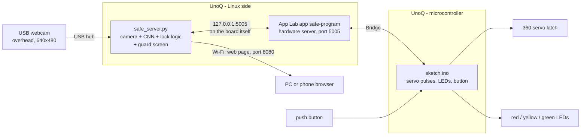
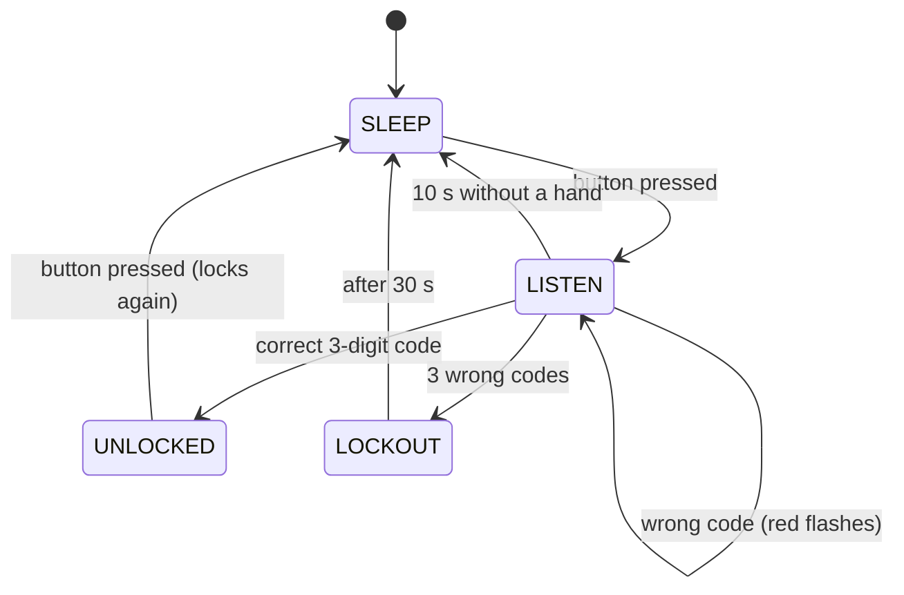

# Impenetrable Safe: how it runs on the Arduino UnoQ

The safe opens when you show a 3-digit code with your fingers under a webcam. The webcam, the
neural network, the lock logic and the servo/LED/button control all run **on the Arduino UnoQ**.
A computer or phone on the same Wi-Fi only opens a web page to watch the guard screen.

---

## 1. The big picture

The UnoQ is two computers on one board:

| Side | What it is | What it does in this project |
|---|---|---|
| **Linux side** (microprocessor) | Quad-core Arm, 3.6 GB RAM, Debian Linux, Python 3.13 | Reads the webcam, runs the PyTorch CNN, runs the lock logic, draws the guard screen, serves the web page |
| **Microcontroller side** (MCU) | Real-time chip running an Arduino sketch | Drives the servo pulses and the 3 LEDs, reads the button |

They talk through the **Bridge**, Arduino's built-in link between the two sides.



**Only the picture goes over Wi-Fi.** The camera, the neural network and the hardware control
never depend on the network, so the safe works even if nobody is watching the web page.

---

## 2. Hardware

| Part | UnoQ pin | Notes |
|---|---|---|
| Servo signal (M5Stack 360 servo) | D9 | red wire to 5V, black/brown to GND |
| Red LED | D5 | through a 220 Ω resistor to GND |
| Yellow LED | D6 | same |
| Green LED | D7 | same |
| Push button | D2 | other leg to GND (internal pull-up, no resistor) |
| USB webcam | USB-C hub on the UnoQ | the hub also powers the board |
| Hall sensor (planned) | D3 | forced-entry detection, not installed yet |

### The servo has no idea where it is
The M5Stack 360 is a **continuous-rotation** servo. The pulse width sets its *speed and
direction*, not an angle: 1500 µs means stop, 1300 µs turns toward "closed", 1700 µs toward
"open". So the board does:

- **lock** = spin at 1300 µs for **500 ms**
- **unlock** = spin at 1700 µs for **500 ms**

Spinning for a fixed time alone drifted badly, because speed changes with voltage, load and
temperature. The fix is mechanical: **physical stops** at the open and closed positions. Each move
spins a little longer than needed and ends pressed against a stop, so every lock and unlock lands
in exactly the same place and errors can't build up. After each move the sketch sends a short
"stop" signal and then no pulses at all, so the servo rests and stays cool. When the safe starts,
it does one full lock spin so the latch begins at a known position.

The UnoQ's microcontroller has no standard `Servo.h` library, so the sketch makes the 50 Hz
servo pulses itself, timed with `micros()` for accuracy.

---

## 3. From camera frame to a digit

Every camera frame goes through the same steps, on the PC during training and on the UnoQ when
running:

1. **Capture.** 640×480 frame from the webcam. Exposure is **locked** (set during calibration),
   because with auto-exposure the camera brightens the paper whenever a hand enters, and the same
   background would look different with and without a hand.
2. **Crop.** Only the area **inside the blue tape border** is kept. The border position comes from
   calibration (`src/calibrate.py`), which finds the tape by its color (blue is far from any skin
   tone, unlike the red tape used at first).
3. **Clean up.** Any strip of tape that slipped into the crop edge is cut off, then the crop is
   **padded to a square** (not stretched), so fingers keep their real shape.
4. **Shrink.** Resize to **64×64 color** and scale pixel values to −1…1.
5. **CNN.** The network, `FingerNet` (built from scratch in PyTorch), outputs a probability for
   each class: 0 (fist) and 1–5 fingers.

### The network (FingerNet, 11,414 parameters)
```
64x64x3 image
  -> conv 3x3, 8 filters  -> ReLU -> max-pool 2   (32x32)  ──┐
  -> conv 3x3, 16 filters -> ReLU -> max-pool 2   (16x16)  ──┤ each scale shrunk to 4x4
  -> conv 3x3, 32 filters -> ReLU -> max-pool 2   (8x8)    ──┘ (adaptive max-pool)
  -> join all three scales: 4x4x(8+16+32) = 896 numbers
  -> fully connected layer -> 6 scores -> softmax -> probabilities for 0..5
```
Using features from **all three depths** lets the last layer see both fine detail (finger edges)
and the overall hand shape.

- **Training (on the PC):** 720 pictures from 3 people (120 per count), class-balanced loss, Adam
  optimizer, random rotation/shift/scale and brightness changes, 60 epochs.
- **On the UnoQ:** the same `finger_net.pt` file runs with CPU PyTorch in **13.6 ms per frame**,
  fast enough for the full camera frame rate.
- **Measured accuracy (single pictures):** about **86%** on my own hand (tested on a recording
  session it never trained on), and **66–81%** on a person it has never seen. The lock rule below
  makes the final decision much more reliable than one picture.

---

## 4. From digits to "unlock": the lock logic

`src/lock_policy.py` is a state machine that runs once per camera frame:



**How a digit is accepted**
- The network must report the **same digit with at least 90% confidence for 10 frames in a row**,
  so one blurry or in-between frame can't enter a digit.
- After a digit, you must show a **fist (0)** before the next one, so holding "3" doesn't enter
  "3, 3, 3".
- The code is 3 different digits from 1–5. It is stored only as a **salted PBKDF2-SHA256 hash**
  (100,000 iterations): the code itself is never saved anywhere.

**What the LEDs mean** (the same on the real board and on the screen)

| Signal | Meaning |
|---|---|
| All three light up briefly | button pressed, show your code |
| Yellow flash | a digit was registered |
| Red flashing (2 s) | wrong code |
| Red on | locked out for 30 s after 3 wrong codes |
| Green flashing (2 s), then green on | correct code, safe unlocked |
| All off | locked and asleep |

**The flow:** press the button → show the digits (fist between each) → green flashes, the servo
turns the latch open → press the button again → the servo locks it.

---

## 5. The software pieces

| File | Runs on | Job |
|---|---|---|
| `unoq/safe_app/sketch/sketch.ino` | UnoQ microcontroller | servo pulses, LED on/off/blink, button debounce + press counting |
| `unoq/safe_app/python/main.py` | UnoQ Linux, inside the App Lab app "safe-program" | hardware server on port 5005: turns simple messages (`out`, `poll`, `servo_run`, ...) into Bridge calls to the sketch; **locks the safe if the vision program disconnects** |
| `src/safe_server.py` | UnoQ Linux (normal Python environment `~/safe/.venv`) | camera + CNN + lock logic + guard screen; streams the screen to `http://<UnoQ IP>:8080` |
| `src/safe_sim.py` | PC | the same screen in a window (for testing without the board, or with `--host` to drive the board from the PC) |
| `src/io_backend.py` | both | talks to the hardware server on a background thread, so network delays never slow down the camera; reconnects automatically |
| `src/preprocess.py`, `src/model.py`, `src/infer.py` | both | the exact same image preparation and network on the PC and the board |

**Why two programs on the board?** App Lab apps are the official way to use the Bridge to the
microcontroller, so the hardware server lives in an App Lab app. PyTorch, OpenCV and the webcam
are simpler to set up in a normal Python environment on the board's Linux, so the vision program
runs there and talks to the App Lab app over the board's internal network (127.0.0.1). The two
are independent: either one can restart without breaking the other.

**The web page** shows the same guard screen as the PC version (LEDs at the top, the guard photo
showing locked or unlocked, the camera view, the current reading with its confidence, and the
code boxes). It also has a "Button" that works like the real one. It is a plain MJPEG stream, so
any browser works, phone included, with nothing to install.

---

## 6. Safety behaviour

- **The vision program stops or crashes:** the hardware server notices the disconnect and
  **locks the servo and turns the LEDs off**.
- **Startup:** one full lock spin against the closed stop, so the latch position is known.
- **Hardware link drops for a moment:** the screen shows "RECONNECTING", the program retries
  every 2 s and re-sends the current state when it's back.
- **Brute force:** 3 wrong codes trigger a 30-second lockout.
- **Forced entry (planned):** with the Hall sensor on the door, opening the door while the servo
  is locked will trigger a breach alarm (red flashing). The logic is already written and tested.

---

## 7. Setting it up (for reference)

On the PC:
```
python unoq/deploy.py <UnoQ IP>          # copies code, model, hashed code, servo timing, photos
```
On the UnoQ (over SSH):
```
sh ~/safe/unoq/setup_board.sh            # Python environment + PyTorch + OpenCV, checks the model
cd ~/safe && .venv/bin/python -m src.calibrate --quick --camera 2    # area EMPTY
.venv/bin/python -m src.safe_server      # start the safe
sh ~/safe/unoq/setup_board.sh --service  # optional: start automatically at power-on
```
In App Lab: run the **safe-program** app (the hardware server).
Then open **`http://<UnoQ IP>:8080`** on the PC or a phone.

---

## 8. How it was tested

- **120 automated tests** on the PC cover:
  - image quality checks and the blue-border detector
  - preprocessing (crop, tape trimming, square padding)
  - the model and saving/loading it
  - the lock state machine (LED signals, lockout, re-lock with the button)
  - the hardware protocol, including disconnect → locked and automatic reconnecting
  - the web page (page, live frames, the web button driving a full unlock)
- **Hardware checks with the real board:**
  - `python -m src.hw_test` steps through each LED, the servo and the button.
  - `python -m src.servo_test` locks and unlocks from the terminal, including a repeat test.
- **Honest accuracy testing:** the network is always scored on pictures from a recording session
  or a person it did not train on. Testing on random pictures from the same session would give
  inflated results, because neighbouring frames look almost identical.
